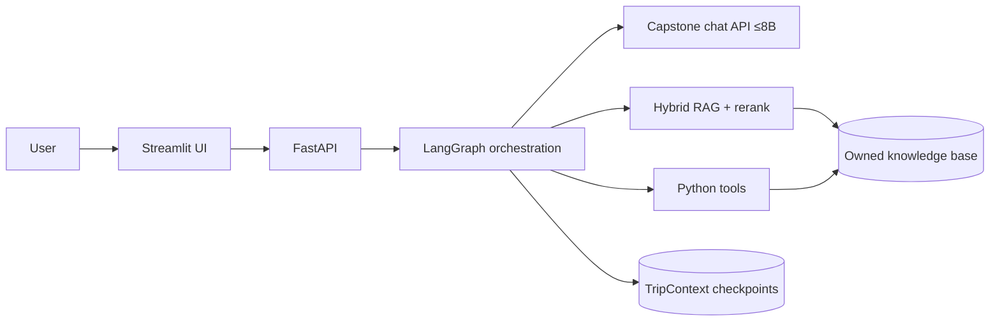
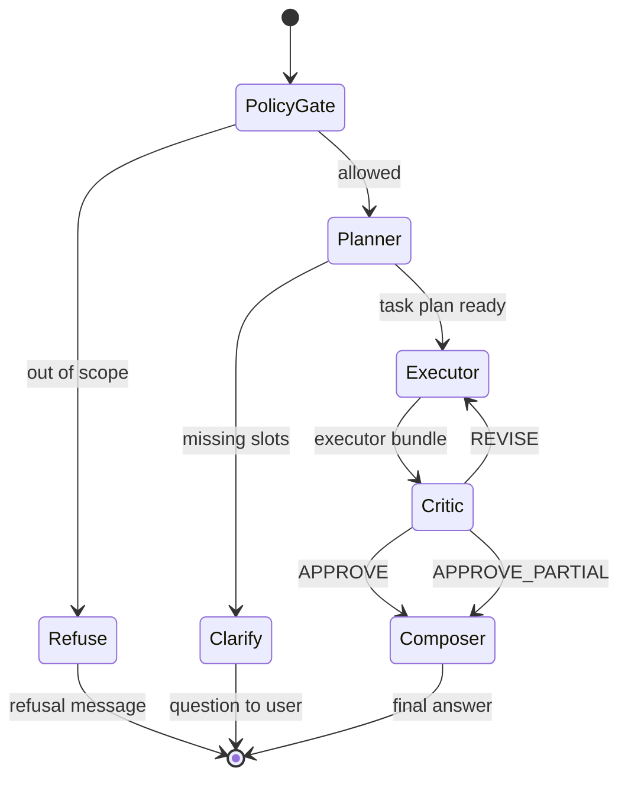
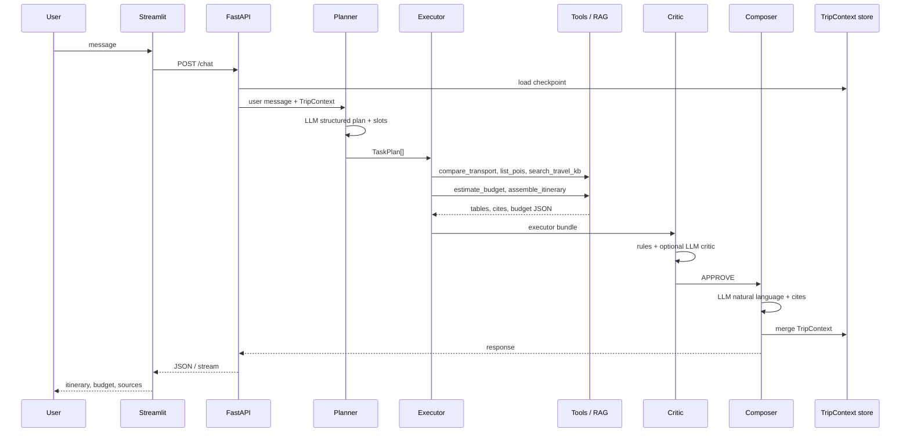
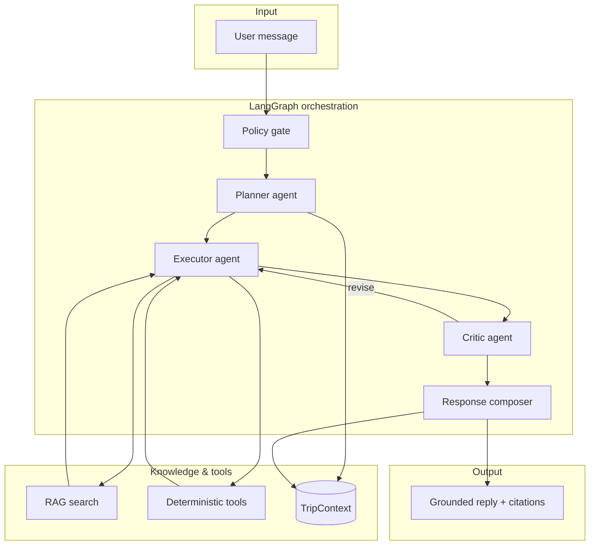

# JourneyX AI — Idea, Agents & End-to-End Flow

This document explains **what JourneyX is**, **which agents it uses**, **how orchestration works**, and **how a request flows** from the user to a grounded travel answer. For build details and capstone compliance, see [IMPLEMENTATION_PLAN.md](../IMPLEMENTATION_PLAN.md). For the executive summary, see [ProjectIdea.md](../ProjectIdea.md).

---

## 1. The idea

**JourneyX AI** is a conversational travel planning assistant for the IIT KGP GenAI capstone (**Track B — API-side**). It helps users discover destinations, compare transport options, find stays and activities, estimate budgets, and build day-wise itineraries — all through natural chat.

### Problem

Trip planning scatters information across many sources. Users repeat the same questions (routes, costs, what to see) and struggle to keep budget and dates consistent while iterating on a plan.

### Approach

JourneyX unifies planning in one interface backed by:

- A **team-owned travel knowledge base** (documents + structured data — no live booking or maps APIs).
- **Hybrid search (RAG)** for destinations, tips, and activities with **citations**.
- **Deterministic tools** for distances, transport comparison, and budget math (so a small **≤8B** hosted model does not invent prices).
- A **multi-agent workflow** (Planner → Executor → Critic) orchestrated with **LangGraph**, with bounded steps and persistent conversation state.

### What it is not

JourneyX **does not book** tickets or hotels, **does not guarantee** live fares, and **does not replace** human judgment for payments, visas, or safety. It produces **indicative plans** that users must verify before acting.

---

## 2. System context (high level)



| Layer | Role |
|-------|------|
| **UI** | Chat, show itinerary, budget, and citations |
| **API** | Rate limits, caching, request IDs, calls the graph |
| **Orchestration** | Agents/nodes, routing, step limits, checkpoints |
| **LLM** | Understand language, plan tasks, compose final reply; structured JSON where needed |
| **RAG + tools** | Facts and numbers from **your data**, not from the model’s memory |

---

## 3. Agents and supporting nodes

JourneyX is described as **three logical agents** (capstone requirement: **planner → executor → critic**). In implementation, these are **LangGraph nodes**. A few **non-LLM nodes** sit before and after them for policy and user experience.

### 3.1 Agent roles at a glance

| Role | Type | Primary job |
|------|------|-------------|
| **Policy gate** | Rules (no LLM) | Refusals: booking, live fares, unsafe/PII requests |
| **Planner** | LLM agent | Intent, extract trip slots, list tasks, or ask to clarify |
| **Executor** | Agent + code | Run RAG and tools; assemble structured results |
| **Critic** | Rules + LLM (hybrid) | Validate grounding, budget, consistency; approve or send back |
| **Response composer** | LLM | Turn approved structured bundle into clear natural language |

### 3.2 Planner agent

**Purpose:** Understand what the user wants this turn and what is still unknown.

**Inputs:** User message, conversation summary, current `TripContext` (destination, dates, budget, etc.).

**Outputs (structured):**

- **Intent** — e.g. discover destination, compare transport, full plan, refine budget, simple Q&A.
- **Slots** — origin, destination, dates, party size, budget, preferences.
- **Task plan** — ordered list of work for the Executor (e.g. `compare_transport`, `list_pois`, `estimate_budget`).
- **Clarifying question** — if required slots are missing (one focused question, not a long form).

**Does not:** Call external APIs, guess prices, or write the final friendly essay (that is the composer).

### 3.3 Executor agent

**Purpose:** Do the work: retrieve knowledge and run calculations **reliably**.

**Behavior:**

- Follows the Planner’s task list.
- Uses **code-first** execution when slots are already known (reduces bad tool calls on an 8B model).
- Invokes capabilities such as:
  - `search_travel_kb` — hybrid BM25 + embeddings + rerank, with citation IDs.
  - `compare_transport`, `get_route_info`, `find_accommodations`, `list_pois`.
  - `estimate_budget` — **deterministic** Python, not LLM math.
  - `assemble_itinerary` — day-wise skeleton from POIs, time, and pace.

**Outputs:** A structured **executor bundle**: tool traces, tables, budget breakdown, candidate itinerary, and all citations.

**Does not:** Skip tools and invent distances or fares; numbers come from the knowledge base or formulas.

### 3.4 Critic agent

**Purpose:** Quality gate before the user sees an answer.

**Checks (deterministic where possible):**

- Required slots satisfied for the claimed intent.
- Budget totals match `estimate_budget` when a budget was requested.
- Factual claims have **citations** or tool record IDs.
- Numbers in prose match tool outputs.
- “Indicative” wording present for prices.

**LLM Critic** runs on heavier tasks (**full plan**, **refine**) after rule checks, to catch grounding and consistency issues.

**Verdicts:**

| Verdict | Meaning |
|---------|---------|
| **APPROVE** | Send to response composer |
| **REVISE** | Send back to Executor with fix instructions (max 2 loops) |
| **APPROVE_PARTIAL** | Return best effort + disclaimer if revise limit hit |
| **CLARIFY** | (Usually from Planner) Ask user for missing info |
| **REFUSE** | (Usually from policy gate) Decline out-of-scope request |

### 3.5 Response composer (supporting node)

**Purpose:** Single place that writes the **user-facing** answer from an **approved** bundle — so the Executor stays factual/structured and tone stays consistent.

Uses the hosted LLM with retrieved/cited content in context; must not add unsupported facts.

---

## 4. How orchestration works

**Engine:** [LangGraph](https://github.com/langchain-ai/langgraph) state machine on **FastAPI**.

**Persistent state:** `TripContext` is checkpointed (e.g. SQLite) so **multi-turn** chat works — changing budget or dates **updates** the plan instead of forgetting prior context.

**Caps (capstone guardrails):**

- **≤10 graph steps** per user message (target happy path **~6**).
- **≤4 LLM calls** per message when possible (Planner + Critic on complex plans + Composer).
- **≤8 tool invocations** per message.
- **≤2 Critic → Executor** revise loops.

**Tracing:** Every node (`planner`, `executor`, `critic`) and tool call is logged for the demo dashboard (Langfuse / JSONL).

### 4.1 Orchestration graph



### 4.2 Why three agents (design intent)

| Agent | Separates… |
|-------|------------|
| **Planner** | *What* to do and *whether* we have enough information |
| **Executor** | *Doing* retrieval and tools correctly and reproducibly |
| **Critic** | *Whether* the result is safe, grounded, and consistent |

This split matches how production copilots are built when the model is small: **narrow LLM roles**, **heavy lifting in tools and data**.

---

## 5. End-to-end flow (single user message)

### 5.1 Sequence diagram

Example: *“Plan 4 days in Jaipur from Delhi for 2 people under ₹25,000 by train.”*



### 5.2 Step-by-step (narrative)

1. **User** sends a message in Streamlit.  
2. **API** assigns `trace_id`, loads **TripContext** for `thread_id`, applies rate limits.  
3. **Policy gate** checks refusal rules (e.g. “book my flight” → refuse without Executor).  
4. **Planner** (LLM, structured output): intent = `full_plan`; slots = Delhi → Jaipur, 4 days, 2 people, ₹25k cap, train preference; tasks for Executor.  
5. **Executor** (mostly code):  
   - Compare train vs other modes from structured `transport_option` data.  
   - Pull POIs and tips via RAG with `[cite:doc_id]`.  
   - Run `estimate_budget` deterministically.  
   - Build day-wise itinerary from POI durations and pace.  
6. **Critic**: verify budget line items, citations on key facts, train preference reflected; LLM pass on full plan if enabled.  
7. **Composer** (LLM): readable summary, day-by-day plan, cost breakdown, “indicative only” note, citation list.  
8. **Checkpoint** saves updated `TripContext` (itinerary, budget, citations) for the next turn.  
9. **UI** renders markdown, tables, and source links.

If the user then says *“Make it ₹20,000 instead”*, the **Planner** classifies **refine**; **Executor** re-runs budget (and maybe cheaper stay tier); **Critic** checks again; state **merges** — previous Jaipur POI choices stay unless invalidated.

### 5.3 Flows that exit early

| Situation | Path |
|-----------|------|
| Booking / live price guarantee | Policy → **Refuse** → user |
| “Where should I go in March?” without budget | Planner → **Clarify** (one question) → user |
| RAG-only question (“Best time to visit Kerala?”) | Planner → Executor (search_kb) → Critic → Composer |
| Tool failure | Executor marks partial → Critic → **APPROVE_PARTIAL** or **REVISE** once |

---

## 6. Data the agents rely on (not separate “agents”)

These are **capabilities** the Executor uses; they are not extra LLM agents.

| Capability | Source |
|------------|--------|
| Narrative facts | Document corpus → hybrid RAG + rerank |
| Prices, routes, durations | Structured tables (cities, routes, transport, stays, POIs) |
| Budget totals | `estimate_budget` formula + `price_assumption` |

Agents **search** only this owned knowledge — no web search or OTA APIs at runtime.

---

## 7. Example: multi-turn refinement

```text
Turn 1 — User: "Suggest a 3-day trip from Bangalore under 15k"
        Planner: CLARIFY → "Which month and travel style (relaxed vs packed)?"

Turn 2 — User: "December, relaxed"
        Planner: discover intent → Executor: lookup_destinations + RAG
        Critic: APPROVE → Composer: shortlist Coorg / Hampi with cites

Turn 3 — User: "Plan Coorg in detail, 2 people"
        Planner: full_plan → Executor: pois, budget, itinerary
        Critic: LLM APPROVE → Composer: full plan
        TripContext: locked destination = Coorg, itinerary v1

Turn 4 — User: "Switch to bus instead of car"
        Planner: refine → Executor: compare_transport only + patch budget
        TripContext: merge transport + budget; itinerary times adjusted
```

---

## 8. Summary diagram (one page)



---

## 9. Related documents

| Document | Contents |
|----------|----------|
| [ProjectIdea.md](../ProjectIdea.md) | Executive summary, features, team, timeline |
| [IMPLEMENTATION_PLAN.md](../IMPLEMENTATION_PLAN.md) | Capstone traceability, schemas, eval, week plan, tech stack |

**Data layer (before LangGraph):** product spec, refusal policy, frozen eval set, and single-agent prompting baseline — see `IMPLEMENTATION_PLAN.md` §9.1.